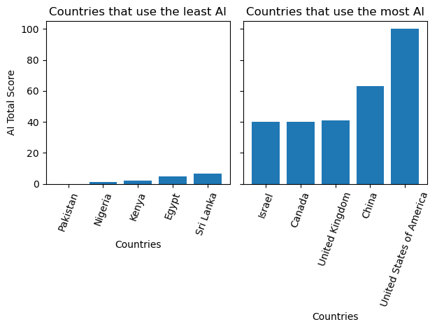
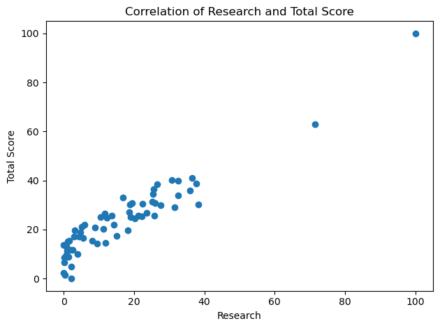
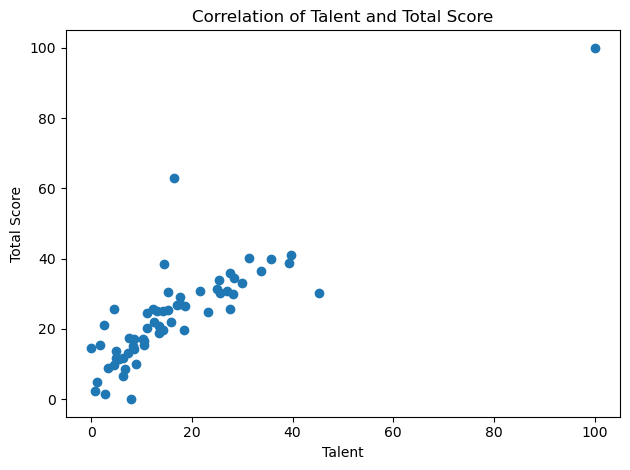
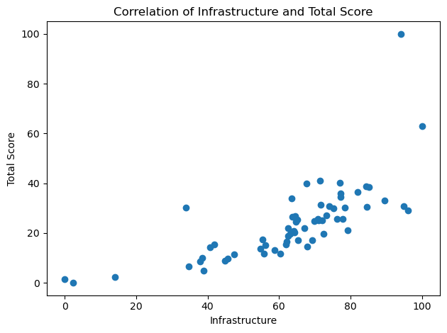
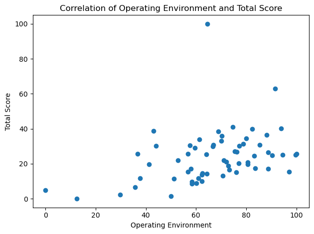
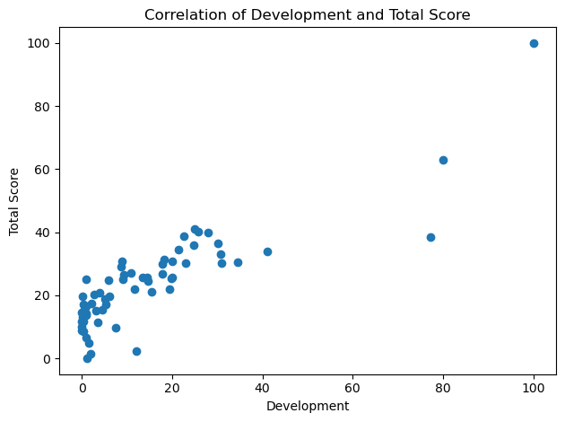
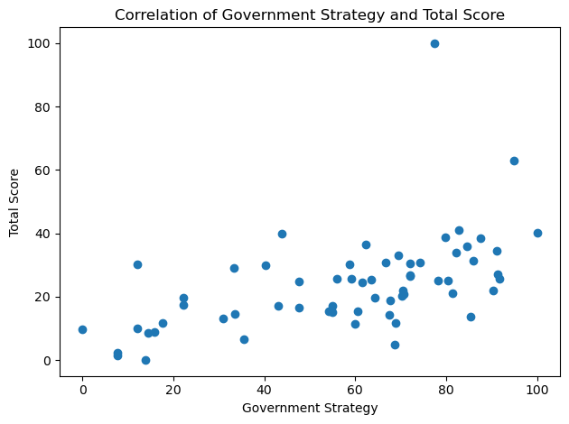
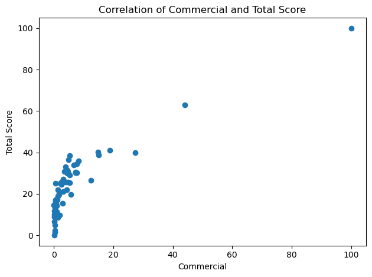

# Personal Projects: Data Analytics Portfolio

I built these data analytics projects on my own time, outside of coursework, to study questions I find interesting. In each one I take a real-world dataset, clean and explore it with Python, turn it into clear visuals, and explain what the numbers mean in plain language.

---

## At a Glance

| | |
|---|---|
| **Focus areas** | Exploratory data analysis (EDA), data visualization, correlation analysis, data storytelling |
| **Languages & tools** | Python 3.12, pandas, Matplotlib, Jupyter Notebook, Google Colab, Git & GitHub |
| **Domain interests** | Artificial intelligence, global economics, technology policy |
| **Projects** | 1 completed ([AI Data Exploration](#-project-1-ai-data-exploration)), more in progress |

---

## Skills Demonstrated

- **Data wrangling with pandas:** loading CSV data into DataFrames, sorting and ranking records, and selecting subsets of the data (`head`/`tail`) to compare the top and bottom of a distribution.
- **Data visualization with Matplotlib:** side-by-side bar charts with shared axes, scatter plots, readable labels and titles, and tidy layouts (`subplots`, `tight_layout`, rotated tick labels).
- **Statistical analysis:** Pearson correlation coefficients that measure how strongly each factor is linked to an outcome, then a ranking of those factors by strength.
- **Analytical reasoning and communication:** turning numbers into conclusions that use economic ideas such as human capital, aggregate demand, and short-run vs. long-run economic growth.
- **Reproducible workflow:** documented Jupyter notebooks with inline comments and a cited source dataset, all under version control on GitHub.

---

## 📊 Project 1: AI Data Exploration

📁 **Folder:** [`AI_Data_Exploration/`](AI_Data_Exploration/)
📓 **Notebook:** [`AI_Data_Exploration_Personal_Project.ipynb`](AI_Data_Exploration/AI_Data_Exploration_Personal_Project.ipynb)
🔗 **Dataset:** [Global AI Index on Kaggle](https://www.kaggle.com/datasets/katerynameleshenko/ai-index)

### The Question

**Which factors are most closely linked to a country's overall strength in artificial intelligence?** Knowing this helps explain why some nations lead in AI and others fall behind. It also shows where investment in talent, research, infrastructure, or policy is likely to pay off the most.

### The Data

The dataset is based on the Global AI Index. It covers **62 countries** and scores each one from 0 to 100 on seven factors, which roll up into an overall **Total Score**:

| Category | Factor | What it measures |
|---|---|---|
| **Implementation** | Talent | Availability of skilled AI practitioners |
| | Infrastructure | Reliability and scale of access to electricity, internet, and supercomputing |
| | Operating Environment | Regulatory context and public opinion on AI |
| **Innovation** | Research | Specialist research output, including publications and citations |
| | Development | Development of the core platforms and algorithms that AI projects rely on |
| **Investment** | Government Strategy | National government commitment, including spending and national AI strategies |
| | Commercial | Startup activity, investment, and business initiatives built on AI |

It also includes categorical context for each country: **Region**, **Cluster** (e.g., *Power players*, *Traditional champions*, *Rising stars*, *Nascent*), **Income group**, and **Political regime**.

### My Approach

1. **Loaded and inspected** the data with pandas to understand its structure and variables.
2. **Ranked all 62 countries** by Total Score to find the leaders and laggards in AI.
3. **Profiled the top 5 and bottom 5 countries**, comparing their income groups, regions, and political regimes for patterns.
4. **Visualized the extremes** in a side-by-side bar chart with a shared y-axis, so the size of the gap is easy to see.
5. **Plotted each of the 7 factors against Total Score** in scatter plots to see the shape of each relationship.
6. **Calculated a Pearson correlation coefficient (r)** for every factor to measure each relationship.
7. **Compared factors within each category** (Implementation, Innovation, Investment) and explained the results in economic terms.

### Key Findings

#### 1. Income level is closely tied to AI strength



- **Lowest-scoring countries:** Pakistan, Nigeria, Kenya, Egypt, and Sri Lanka. All five are in the **lower-middle income** group and are classified as *Nascent* in AI.
- **Highest-scoring countries:** the United States, China, the United Kingdom, Canada, and Israel. All five are **high or upper-middle income**.
- The United States has the top Total Score (100), and China is a distant second (~63). After that, scores drop to around 40, which shows how concentrated global AI capability is.

#### 2. Research is the factor most closely linked to AI strength

Ranked by correlation with Total Score:

| Rank | Factor | Category | Correlation (r) | Strength |
|:---:|---|---|:---:|---|
| 1 | **Research** | Innovation | **0.95** | Very strong positive |
| 2 | Development | Innovation | 0.87 | Strong positive |
| 3 | Talent | Implementation | 0.86 | Strong positive |
| 4 | Commercial | Investment | 0.86 | Strong positive |
| 5 | Infrastructure | Implementation | 0.72 | Moderate–strong positive |
| 6 | Government Strategy | Investment | 0.53 | Moderate positive |
| 7 | Operating Environment | Implementation | 0.37 | Weak positive |

<p align="center">
  
  
</p>

#### 3. The strongest factor in each category

- **Implementation → Talent (r = 0.86).** A country's pool of skilled AI practitioners matters more than its infrastructure or regulatory environment. This fits the economic view that **human capital drives long-run economic growth**.
- **Innovation → Research (r = 0.95).** Ongoing research, measured by publications and citations, is the factor most closely linked to AI leadership in the whole dataset. Research improves existing AI technologies, which also supports long-run growth.
- **Investment → Commercial (r = 0.86).** Private-sector activity (startups, investment, and business adoption) is much more closely linked to AI strength than government strategy (r = 0.53). Commercial activity is tied to **business confidence and aggregate demand**, which can drive **short-run economic growth**.

#### 4. Policy alone is not enough

The two policy-related factors, **Government Strategy (r = 0.53)** and **Operating Environment (r = 0.37)**, have the weakest links to Total Score. National strategies and favorable regulation help, but they do not lead to AI leadership on their own. Countries also need the talent, research, and commercial activity to back them up.

<details>
<summary><strong>View all scatter plots</strong></summary>

| | |
|---|---|
|  |  |
|  |  |
|  |  |
|  | |

</details>

### Why It Matters

These results suggest that countries hoping to grow their AI capability should **invest first in research and talent** and support a healthy **commercial ecosystem**, not depend only on top-down government strategy. The same approach of ranking, visualizing, and measuring which factors drive an outcome can be used for many business questions. Examples include which product features drive customer retention, or which marketing channels are most closely linked to revenue.

### Tools Used

`Python` · `pandas` · `Matplotlib` · `Jupyter Notebook` · `Google Colab`

---

## How to Run the Projects

1. **Clone the repository**
   ```bash
   git clone https://github.com/Niharika-Rai/personal-projects.git
   ```
   ```bash
   cd personal-projects
   ```

2. **Install the dependencies**
   ```bash
   pip install pandas matplotlib jupyter
   ```

3. **Download the dataset.** Get `AI_index_db.csv` from [Kaggle](https://www.kaggle.com/datasets/katerynameleshenko/ai-index) and put it in the `AI_Data_Exploration/` folder.

4. **Launch the notebook**
   ```bash
   jupyter notebook AI_Data_Exploration/AI_Data_Exploration_Personal_Project.ipynb
   ```
   You can also upload the notebook and CSV to [Google Colab](https://colab.research.google.com/) and run it in your browser with no setup.

---

## Repository Structure

```
personal-projects/
├── README.md                                        # Portfolio overview (this file)
└── AI_Data_Exploration/
    ├── AI_Data_Exploration_Personal_Project.ipynb   # Full analysis notebook
    └── images/                                      # Charts generated by the notebook
```

---

## About Me

I'm a student interested in data analytics, economics, and technology. I enjoy using data to answer real-world questions and explaining the results clearly. I'm currently looking for **internship and entry-level opportunities in data analytics, business intelligence, and related roles**.

📫 You can reach me through my [GitHub profile](https://github.com/Niharika-Rai). I'm always happy to talk about data, projects, or opportunities.
